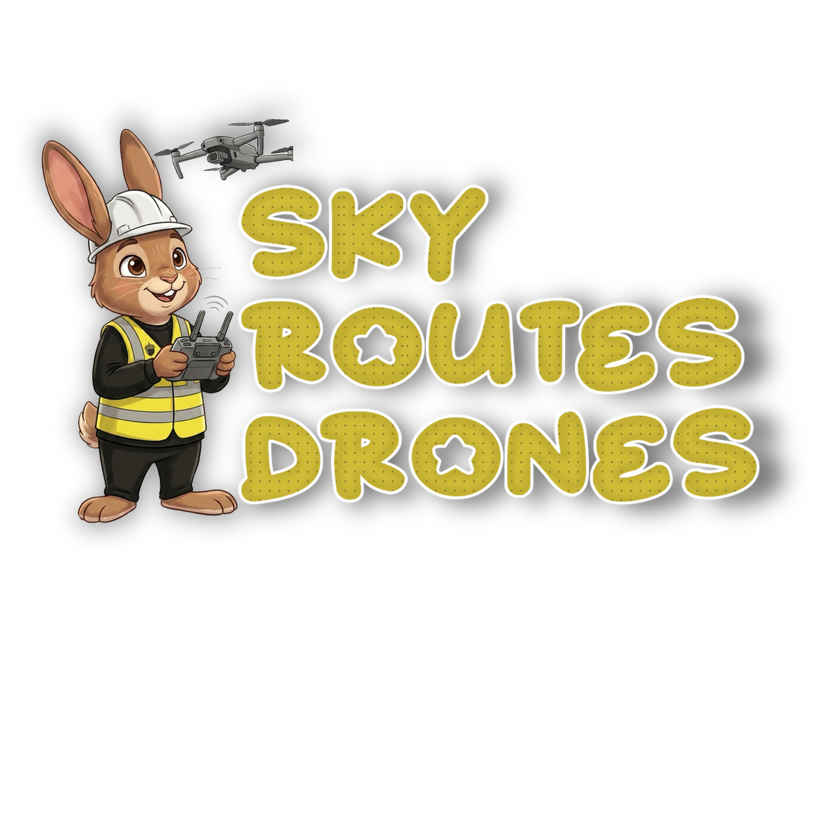

# SkyRoute: Sistema de Gestión, Telemetría y Simulación Cinemática para Drones

[](https://www.python.org/)
[](src/)
[](LICENSE)
[](main.py)

---

<p align="center">
  
</p>

Plataforma integral de orquestación logística, despacho polimórfico, telemetría sensorial en tiempo real y simulación física cinemática discreta para flotas de aeronaves no tripuladas (UAV) en el entorno metropolitano del Valle de Aburrá (Antioquia, Colombia).

---

## 1. Información Institucional y Equipo de Desarrollo

* **Institución:** Universidad de Medellín (UDEM)
* **Facultad:** Facultad de Ingenierías
* **Programa:** Ingeniería de Sistemas
* **Asignatura:** Algoritmos de Programación Orientada a Objetos
* **Semestre:** 2026-2
* **Docente:** Mario Alejandro Saldarriaga (Grupo 62)

### Matriz de Distribución de Responsabilidades Técnicas

| Integrante | Módulos Asignados | Componentes Clave y Alcance Técnico |
|---|---|---|
| **Alejandro García Jiménez** | Módulo de Geodesia, Telemetría, Excepciones, Servicios y Motor de Simulación | Motor trigonométrico Haversine (`ICalculadorGeodesico`), trama sensorial WGS84 (`TelemetriaDrone`), taxonomía de excepciones de dominio, cadena de contingencia cartográfica (ArcGIS, Google, OSM, Catálogo Local), telemetría climática Open-Meteo, reloj monotónico no bloqueante (`RelojSimulacion`) y motor cinemático de vuelo físico multi-fase (`SimuladorVuelo`). |
| **Juan Manuel Pava Higuita** | Módulo de Flota y Consumo Polimórfico | Jerarquía de aeronaves bajo contrato abstracto `Dron(ABC)`, 6 subclases especializadas de la flota, despacho dinámico de consumo de batería por morfología y ciclo de vida de vuelo sin teletransportación (Sprints 1 y 2). |
| **Valery Arboleda Ardila** | Módulo de Gestión Comercial, Auditoría y Orquestación de Control | Entidad `Usuario` (control de acceso RBAC e integridad), entidad `Pedido` (soporte de destino geográfico dual y ciclo de 5 estados), orquestador central `SistemaCentroControl`, fábrica dinámica `FABRICA_DRONES`, asignación por autonomía de circuito y bitácora estructurada `LogOperacion`. |

---

## 2. Pilares de Programación Orientada a Objetos y Principios SOLID

El sistema implementa de forma estricta los principios de diseño de software y la programación orientada a objetos:

1. **Abstracción Formal (`abc.ABC` y `typing.Protocol`):**
   * La clase base `Dron(ABC)` impide la instanciación de aeronaves genéricas, definiendo como abstractos los métodos de misión (`ejecutar_mision`), consumo (`calcular_consumo_estimado`) y diagnóstico (`inspeccionar_sistemas_especializados`).
   * Los servicios externos definen contratos estructurales desacoplados mediante protocolos (`ICalculadorGeodesico`, `IServicioGeocodificador`).
2. **Herencia Jerárquica:**
   * Las 6 subclases de la flota (`DronEntregaLigera`, `DronCargaPesada`, `DronVigilancia`, `DronMapeo`, `DronInspeccion`, `DronRescate`) heredan de `Dron`, reutilizando constructor, odómetro, enlace sensorial y cinemática base mediante `super().__init__(...)`.
3. **Polimorfismo Dinámico (Despacho en Tiempo de Ejecución):**
   * El centro de control (`SistemaCentroControl`) y el simulador cinemático interactúan polimórficamente con cualquier aeronave a través de la interfaz común `Dron`, calculando consumos y ejecutando misiones sin bifurcaciones rígidas `if/elif`.
4. **Principios SOLID Aplicados:**
   * **Single Responsibility Principle (SRP):** Desacoplamiento total entre telemetría física, cálculo geodésico, simulación cinemática, resolución cartográfica y orquestación.
   * **Open/Closed Principle (OCP):** El catálogo `FABRICA_DRONES` permite dar de alta nuevas subclases mediante `registrar_subclase_en_fabrica` sin modificar el código fuente del centro de control.
   * **Dependency Inversion Principle (DIP):** Los orquestadores reciben dependencias inyectadas en su constructor (`IServicioGeocodificador`, `ICalculadorGeodesico`, `RelojSimulacion`, `ServicioClimaAburra`).

---

## 3. Arquitectura del Sistema y Catálogo de Módulos (`src/`)

```
+---------------------------------------------------------------------------------------------------+
|                                      CAPA DE PRESENTACIÓN                                         |
|   - main.py (Consola Interactiva)                  - src/ui/servidor.py (Servidor Web HTTP)       |
|   - src/ui/controlador.py (API REST Telemetría)    - src/ui/estaticos/ (Dashboard Leaflet.js)    |
+---------------------------------------------------------------------------------------------------+
                                                  |
+---------------------------------------------------------------------------------------------------+
|                                 CAPA DE ORQUESTACIÓN Y CONTROL                                    |
|   - src/control/centro_control.py: Torre de Control Centralizada y vertipuerto Olaya Herrera      |
|   - src/control/reloj.py: Controlador de tiempo monotónico no bloqueante (time.monotonic)        |
|   - src/control/simulador.py: Motor de integración cinemática y física discreta multi-fase        |
|   - src/control/log_operacion.py: Bitácora estructurada de auditoría aeronáutica                  |
+---------------------------------------------------------------------------------------------------+
         |                                        |                                        |
+--------------------+                   +--------------------+                   +--------------------+
|   CAPA DE FLOTA    |                   |   CAPA DE DEMANDA  |                   | CAPA DE SERVICIOS  |
| - src/flota/dron.py|                   | - src/pedidos/     |                   | - src/servicios/   |
|   (Base ABC)       |                   |   (Destino dual)   |                   |   geocodificador.py|
| - 6 Subclases      |                   | - src/usuarios/    |                   |   (ArcGIS/Google/  |
|   especializadas   |                   |   (Control RBAC)   |                   |    OSM/Local)      |
|   de aeronaves     |                   +--------------------+                   | - clima.py (Meteo) |
+--------------------+                                                            +--------------------+
         |                                                                                 |
+---------------------------------------------------------------------------------------------------+
|                                  CAPA SENSORIAL Y GEODÉSICA                                       |
|   - src/telemetria/telemetria.py: Trama física de sensores, coherencia de vuelo y rangos WGS84    |
|   - src/geodesia/calculador.py: Motor Haversine, enclavamiento numérico, waypoints y geocerca     |
|   - src/excepciones/errores.py: Taxonomía de excepciones de dominio aeronáutico                  |
+---------------------------------------------------------------------------------------------------+
```

### Documentación Técnica por Módulo

Cada paquete de la solución cuenta con su propio manual técnico detallado:

* **[`src/geodesia/README.md`](src/geodesia/README.md):** Motor trigonométrico Haversine, interpolación de waypoints (`calcular_punto_intermedio`), enclavamiento numérico IEEE 754 y geocerca metropolitana.
* **[`src/flota/README.md`](src/flota/README.md):** Contrato abstracto `Dron(ABC)`, catálogo de las 6 subclases especializadas, tasas de consumo energético, tolerancia de aterrizaje en vertipuerto (50 m) y ciclo de vida de vuelo.
* **[`src/control/README.md`](src/control/README.md):** Torre de control `SistemaCentroControl`, Base Central Olaya Herrera `(6.219603, -75.586792)`, asignación por autonomía de circuito (ida + vuelta), despacho polimórfico, reloj monotónico y motor de simulación cinemática.
* **[`src/servicios/README.md`](src/servicios/README.md):** Cadena de contingencia cartográfica multinivel (`IServicioGeocodificador`: Esri ArcGIS, Google Maps, OpenStreetMap Nominatim y Catálogo Local de 22 hitos) y telemetría meteorológica Open-Meteo.
* **[`src/telemetria/README.md`](src/telemetria/README.md):** Trama sensorial `TelemetriaDrone`, coherencia física entre altitud y motores, rangos WGS84 y actualización atómica de tramas.
* **[`src/pedidos/README.md`](src/pedidos/README.md):** Entidad `Pedido`, soporte de destino geográfico dual (coordenadas / dirección urbana con geocodificación diferida), alias de compatibilidad y ciclo de vida de 5 estados.
* **[`src/usuarios/README.md`](src/usuarios/README.md):** Entidad `Usuario`, catálogo formal de roles autorizados (`CLIENTE`, `OPERADOR_VUELO`, `ADMINISTRADOR`), tipado estricto y métodos de integridad.
* **[`src/excepciones/README.md`](src/excepciones/README.md):** Taxonomía completa de excepciones de dominio aeronáutico (`BateriaInvalidaError`, `AltitudInvalidaError`, `EstadoMotorInvalidoError`, `CoordenadaInvalidaError`, jerarquía `DronError` y `GeocodificacionError`).

---

## 4. Matriz de Requisitos Funcionales e Historias de Usuario

| Código | Requisito Funcional | Historia de Usuario | Módulos Involucrados | Responsable Técnico | Estado |
|---|---|---|---|---|---|
| **RF-01** | Validar e instanciar trama de telemetría | **HU-01** | `src/telemetria/`, `src/excepciones/` | Alejandro García | Verificado |
| **RF-02** | Notificar excepciones de dominio específicas | **HU-01**, **HU-03** | `src/excepciones/` | Alejandro García / Juan M. Pava | Verificado |
| **RF-03** | Calcular distancia ortodrómica a destino | **HU-02**, **HU-04** | `src/geodesia/`, `src/flota/` | Alejandro García / Juan M. Pava | Verificado |
| **RF-04** | Consultar ficha técnica y formato en consola | **HU-03**, **HU-10** | `src/flota/` | Juan M. Pava | Verificado |
| **RF-05** | Actualizar telemetría de la flota activa | **HU-04**, **HU-12** | `src/flota/`, `src/control/` | Alejandro García / Valery Arboleda | Verificado |
| **RF-06** | Registrar usuarios con roles válidos | **HU-05** | `src/usuarios/` | Valery Arboleda | Verificado |
| **RF-07** | Registrar solicitud de servicio con requerimientos | **HU-05**, **HU-08**, **HU-09**, **HU-11** | `src/pedidos/`, `src/servicios/` | Valery Arboleda / Alejandro García | Verificado |
| **RF-08** | Asignación inteligente por categoría y autonomía | **HU-06**, **HU-12** | `src/control/`, `src/flota/` | Valery Arboleda / Alejandro García | Verificado |
| **RF-09** | Gestionar retorno obligatorio a la base central | **HU-04**, **HU-06**, **HU-12** | `src/control/`, `src/flota/` | Valery Arboleda / Juan M. Pava | Verificado |
| **RF-10** | Calcular tiempo estimado de viaje (ETA) | **HU-02**, **HU-04** | `src/geodesia/`, `src/flota/` | Alejandro García / Juan M. Pava | Verificado |
| **RF-11** | Geocodificar y resolver cartográficamente direcciones urbanas | **HU-05**, **HU-06** | `src/servicios/`, `src/pedidos/` | Alejandro García | Verificado |
| **RF-12** | Despachar misiones y ejecutar comportamientos polimórficos | **HU-12** | `src/control/`, `src/flota/` | Valery Arboleda / Alejandro García | Verificado |
| **RF-13** | Simular cinemática de vuelo multi-fase con modulación climática | **HU-12** | `src/control/`, `src/servicios/` | Alejandro García | Verificado |
| **RF-14** | Monitorear telemetría y cartografía en interfaz gráfica web | **HU-12** | `src/ui/`, `src/control/` | Alejandro García | Verificado |

---

## 5. Innovaciones de Ingeniería Destacadas

### 5.1 Simulación Cinemática Multi-Fase Discreta
A diferencia de sistemas convencionales que teletransportan instantáneamente las aeronaves al destino, SkyRoute implementa un motor cinemático temporal (`SimuladorVuelo`):
* **Propagación de Tiempo Remanente:** Si un intervalo de tiempo ($\Delta t$) cubre la llegada a destino, la aeronave inicia inmediatamente la fase de retorno hacia la base en el mismo pulso temporal.
* **Modulación por Condiciones Meteorológicas:** La velocidad efectiva de vuelo es modulada en tiempo real según el viento y la lluvia del Valle de Aburrá:
  $$v_{\text{efectiva}} = v_{\text{promedio}} \times \max(0.1, \min(1.0, \text{factor\_clima}))$$
* **Protocolo de Aterrizaje de Emergencia por Agotamiento (0.0%):** Si la batería llega a 0% en vuelo, el simulador interpola la coordenada intermedia exacta mediante `calcular_punto_intermedio()`, fuerza motores a `'STANDBY'`, cota a 0 m y emite alerta crítica de auditoría.

### 5.2 Medición de Tiempo Monotónico de Hardware
El módulo `RelojSimulacion` utiliza `time.monotonic()` en lugar del reloj de pared del sistema operativo (`time.time()`). Esto garantiza inmunidad absoluta contra desajustes de reloj local, saltos de hora por sincronización NTP o cambio de horario de verano.

### 5.3 Asignación por Autonomía de Circuito Completo
El método `asignar_dron_a_pedido()` calcula previamente la distancia y consumo de energía tanto de ida al cliente como de regreso a la base central. Si $\text{batería} < C_{\text{ida}} + C_{\text{retorno}}$, la aeronave es descartada informativamente, impidiendo que drones queden varados en el territorio urbano.

### 5.4 Cadena Cartográfica con Resiliencia Offline-First
La resolución de direcciones urbanas implementa una jerarquía de contingencia: si la red falla o la dirección presenta nomenclatura compleja, el sistema desciende ordenadamente desde Esri ArcGIS hacia Google Maps, OpenStreetMap Nominatim y finalmente hacia un catálogo local determinista con 22 puntos de referencia del Valle de Aburrá.

---

## 6. Estructura del Repositorio

```
SkyRouteDrones/
├── docs/                                 # Documentación formal de análisis y metodología UDEM
│   ├── 01_descripcion_del_problema.md    # Contexto geográfico y formulación del problema
│   ├── 02_requisitos_funcionales.md      # Requisitos funcionales (RF-01 a RF-10) y reglas de negocio
│   ├── 03_modelo_del_mundo.md            # Diagrama de clases UML y diseño del modelo de dominio
│   ├── 06_historial_de_cambios_hu.md     # Registro de trazabilidad y reconciliación técnica HU-01 a HU-12
│   └── Entregas/
│       ├── 04_historias_de_usuario_sprint1.md # Historias de usuario HU-01 a HU-06 (Sprint 1)
│       └── 05_historias_de_usuario_sprint2.md # Historias de usuario HU-07 a HU-12 (Sprint 2)
│
├── imagenes/                             # Activos visuales y manual de identidad del proyecto
│   └── skyroutes-imagen.png              # Logotipo oficial de SkyRoute Drones
│
├── src/                                  # Código fuente de producción
│   ├── control/                          # Centro de control, simulador, reloj y auditoría
│   ├── excepciones/                      # Excepciones de dominio aeronáutico y geodésico
│   ├── flota/                            # Jerarquía de aeronaves especializadas (Dron ABC + 6 subclases)
│   ├── geodesia/                         # Motor trigonométrico Haversine y cálculo de ETA
│   ├── pedidos/                          # Gestión de solicitudes de servicio con destino dual
│   ├── servicios/                        # Geocodificación multinivel y telemetría de clima
│   ├── telemetria/                       # Trama sensorial WGS84 y coherencia de sustentación
│   ├── ui/                               # Interfaz gráfica web interactiva y servidor HTTP
│   ├── usuarios/                         # Gestión de identidades y control de acceso RBAC
│   ├── main.py                           # Demostración de integración de paquetes
│   └── README.md                         # Guía de arquitectura interna de src/
│
├── main.py                               # Consola interactiva del Centro de Operaciones
├── requirements.txt                      # Dependencias del proyecto (requests)
├── LICENSE                               # Licencia de software MIT
└── README.md                             # Este documento principal
```

---

## 7. Instalación y Guía de Ejecución

### 7.1 Requisitos Previos
* **Python:** Versión 3.10 o superior instalada.
* **Entorno Virtual (Recomendado):**
  ```bash
  python -m venv venv
  # En Windows:
  venv\Scripts\activate
  # En Linux / macOS:
  source venv/bin/activate
  ```

### 7.2 Instalación de Dependencias
```bash
pip install -r requirements.txt
```

### 7.3 Ejecución de la Consola Interactiva
Inicia el centro de operaciones en modo consola, permitiendo gestionar la flota, registrar pedidos, despachar misiones polimórficas y avanzar la simulación en tiempo real:
```bash
python main.py
```

### 7.4 Ejecución de la Interfaz Gráfica Web Interactiva
Levanta el servidor local HTTP para visualizar la cartografía interactiva del Valle de Aburrá con Leaflet.js, seguimiento de aeronaves y paneles de control:
```bash
python -m src.ui
```
Luego, abra en su navegador web: `http://localhost:8000`

### 7.5 Ejecución de la Suite Completa de Pruebas Unitarias
El proyecto cuenta con 77 pruebas unitarias automatizadas que cubren el 100% de los requisitos funcionales y reglas de negocio:
```bash
python -m unittest discover -s src -p "test*.py"
```

---

## 8. Trazabilidad de Decisiones Técnicas

Todas las discrepancias entre la especificación académica original (Sprints 1 y 2) y la implementación final de producción se encuentran minuciosamente auditadas y justificadas en el documento central:

* **[Documento 06: Historial de Cambios y Reconciliación de Historias de Usuario (`docs/06_historial_de_cambios_hu.md`)](docs/06_historial_de_cambios_hu.md)**

---

## 9. Licencia

Este proyecto se distribuye bajo los términos de la [Licencia MIT](LICENSE). Consulte el archivo para mayores detalles.