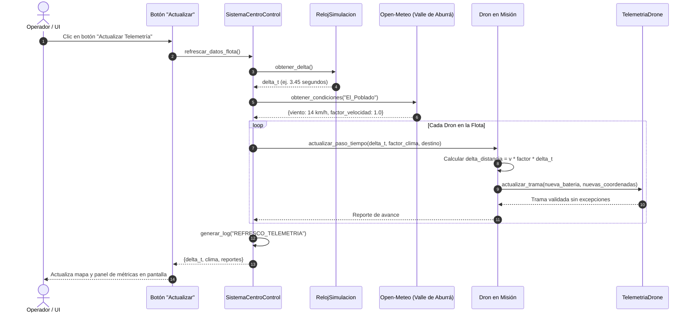

# Solución Arquitectónica: Medición de Tiempo No Bloqueante ($\Delta t$) y Actualización de Métricas bajo Demanda

**Proyecto:** SkyRoute - Sistema de Gestión y Telemetría para Drones  
**Institución:** Universidad de Medellín (UDEM)  
**Asignatura:** Algoritmos de Programación Orientada a Objetos  
**Semestre:** 2026-2  

---

## 1. Diagnóstico del Problema y Justificación

### 1.1 Situación Actual en SkyRoute
En la implementación actual del proyecto:
* El método `refrescar_datos_flota()` en [`src/control/centro_control.py`](src/control/centro_control.py) actúa como un *placeholder* estático: cuenta cuántas aeronaves hay en la lista y emite un log, pero **no calcula el paso del tiempo, ni simula desplazamiento físico, ni descarga de batería**.
* Las aeronaves que entran en misión o en retorno a base permanecen congeladas en sus coordenadas iniciales a menos que se fuerce una nueva telemetría manual.

### 1.2 El Desafío del Tiempo en Interfaces Gráficas
Si intentamos simular el vuelo mediante un bucle continuo tradicional:
```python
# ❌ ERROR CLÁSICO: Congela la ventana de Tkinter / PyQt y la deja como "No Responde"
while True:
    dron.avanzar()
    time.sleep(1)  # Bloquea el hilo principal de la interfaz
```
Para resolver esto de forma limpia, robusta y con POO, adoptamos el patrón **Reloj Delta ($\Delta t$)** propuesto en la guía del proyecto, combinándolo con la consulta de variables meteorológicas reales sin autenticación (Open-Meteo).

---

## 2. Fundamento Matemático y Físico del Reloj Delta ($\Delta t$)

En lugar de asumir que pasa un segundo exacto entre pulsaciones, el sistema mide con precisión cuántos segundos reales transcurrieron entre dos eventos mediante `time.monotonic()`:

$$\Delta t = t_{\text{actual}} - t_{\text{última\_actualización}}$$

A partir de este $\Delta t$ (en segundos), la física del dron se actualiza discretamente:

1. **Velocidad Efectiva:**
   $$v_{\text{efectiva}} = \left(\frac{v_{\text{crucero\_kmh}}}{3600}\right) \cdot \text{factor\_clima} \quad [\text{km/s}]$$
2. **Desplazamiento en el Intervalo:**
   $$\Delta d = v_{\text{efectiva}} \cdot \Delta t \quad [\text{km}]$$
3. **Consumo de Batería Diferenciado (Polimórfico):**
   $$\Delta \text{Batería} = \text{tasa\_consumo\_base} \cdot \Delta t \cdot \text{factor\_arrastre} \quad [\%]$$
4. **Avance Geográfico Discreto:**
   Se calcula la fracción de la ruta completada y se actualiza la tupla `(latitud, longitud)` del dron en dirección a su coordenada de destino o a la base central.

---

## 3. Arquitectura de Clases Propuesta para SkyRoute

A continuación se detalla cómo adaptar los dos conceptos de la guía a la estructura real de carpetas y clases de nuestro repositorio:

```text
src/
├── control/
│   ├── centro_control.py     <-- Orquesta flota, reloj, clima y simulador
│   ├── reloj.py              <-- [NUEVO] Clase RelojSimulacion con time.monotonic()
│   ├── simulador.py          <-- [NUEVO] Clase SimuladorVuelo (cinemática, física y Delta t)
│   └── log_operacion.py      <-- Auditoría inmutable de eventos
├── servicios/
│   └── clima.py              <-- [NUEVO] Clase ServicioClimaAburra (Open-Meteo No-Auth)
├── flota/
│   └── dron.py               <-- Entidad pura Dron (sin concentración de física ni simulación temporal)
└── geodesia/
    └── calculador.py         <-- Haversine, ETA, interpolación dentro de Aburrá
```

---

## 4. Implementación Detallada de Componentes

### 4.1 Componente 1: `RelojSimulacion` (`src/control/reloj.py`)
Mide intervalos de tiempo precisos y no bloqueantes utilizando el reloj monótono del sistema operativo:

```python
# src/control/reloj.py
import time

class RelojSimulacion:
    """
    Controlador de tiempo no bloqueante para simulación discreta de telemetría.
    Utiliza time.monotonic() para evitar distorsiones por cambios de hora del SO.
    """
    def __init__(self):
        self.tiempo_inicio = time.monotonic()
        self.ultima_actualizacion = self.tiempo_inicio
        self.pausado = False

    def obtener_tiempo_total_seg(self) -> float:
        """Retorna los segundos totales transcurridos desde que inició el sistema."""
        return round(time.monotonic() - self.tiempo_inicio, 2)

    def obtener_delta(self) -> float:
        """
        Retorna los segundos exactos transcurridos desde la última invocación del hook.
        Reinicia la marca temporal para el siguiente ciclo.
        """
        ahora = time.monotonic()
        delta_t = ahora - self.ultima_actualizacion
        self.ultima_actualizacion = ahora
        return max(0.0, delta_t)

    def reiniciar(self):
        """Reinicia el reloj de simulación."""
        self.tiempo_inicio = time.monotonic()
        self.ultima_actualizacion = self.tiempo_inicio
```

---

### 4.2 Componente 2: `ServicioClimaAburra` (`src/servicios/clima.py`)
Consume la API pública de **Open-Meteo** para puntos estratégicos del Valle de Aburrá sin necesidad de API Keys ni cuentas de pago:

```python
# src/servicios/clima.py
import requests

class ServicioClimaAburra:
    """
    Servicio de telemetría meteorológica en tiempo real para el Valle de Aburrá.
    Cero autenticación (Open-Meteo No-Auth).
    """
    NODOS_ABURRA = {
        "Medellin_Centro": {"lat": 6.2442, "lon": -75.5812},
        "El_Poblado": {"lat": 6.2089, "lon": -75.5684},
        "Belen": {"lat": 6.2319, "lon": -75.6105},
        "Envigado": {"lat": 6.1759, "lon": -75.5917},
        "Bello": {"lat": 6.3373, "lon": -75.5579},
        "Sabaneta": {"lat": 6.1515, "lon": -75.6166}
    }

    def __init__(self):
        self.url_base = "https://api.open-meteo.com/v1/forecast"

    def obtener_condiciones(self, nombre_nodo: str = "Medellin_Centro") -> dict:
        coordenadas = self.NODOS_ABURRA.get(nombre_nodo, self.NODOS_ABURRA["Medellin_Centro"])
        parametros = {
            "latitude": coordenadas["lat"],
            "longitude": coordenadas["lon"],
            "current": "temperature_2m,precipitation,wind_speed_10m,wind_gusts_10m",
            "timezone": "America/Bogota"
        }

        try:
            resp = requests.get(self.url_base, params=parametros, timeout=4)
            resp.raise_for_status()
            datos = resp.json()["current"]
            viento = datos["wind_speed_10m"]
            lluvia = datos["precipitation"]

            # Factor de reducción de velocidad: viento fuerte reduce rendimiento
            factor_velocidad = 0.80 if viento > 25.0 else (0.90 if viento > 15.0 else 1.0)

            return {
                "nodo": nombre_nodo,
                "temperatura_c": datos["temperature_2m"],
                "lluvia_mm": lluvia,
                "viento_kmh": viento,
                "factor_velocidad": factor_velocidad,
                "vuelo_seguro": lluvia < 2.0 and viento < 35.0
            }
        except Exception as e:
            # Tolerancia a fallos: valores por defecto si no hay conexión en sustentación
            return {
                "nodo": nombre_nodo,
                "temperatura_c": 22.0,
                "lluvia_mm": 0.0,
                "viento_kmh": 12.0,
                "factor_velocidad": 1.0,
                "vuelo_seguro": True,
                "fallback": True
            }
```

---

### 4.3 Componente 3: `SimuladorVuelo` (`src/control/simulador.py`)
Para evitar la concentración excesiva de responsabilidades en [`src/flota/dron.py`](src/flota/dron.py) (antipatrón *God Class*), el cálculo de física cinemática, factores atmosféricos y avance discreto se traslada a la clase desacoplada `SimuladorVuelo`:

```python
# src/control/simulador.py
class SimuladorVuelo:
    """
    Motor de simulación física y cinemática para aeronaves en el Valle de Aburrá.
    Calcula pasos discretos de tiempo (Delta t), interpolación espacial y consumo de energía.
    """
    def __init__(self, calculador: ICalculadorGeodesico | None = None) -> None:
        self.calculador = calculador or CalculadorGeodesico()

    def avanzar_paso_tiempo(
        self,
        dron: Dron,
        delta_t: float,
        factor_clima: float = 1.0,
        coordenada_objetivo: tuple[float, float] | None = None
    ) -> dict:
        if delta_t <= 0.0 or not (dron.en_mision or dron.retornando_a_base):
            return {"id": dron.id_dron, "estado": "ESTACIONARIO", "delta_km": 0.0}

        # 1. Determinar objetivo geográfico (destino o base)
        objetivo = coordenada_objetivo or (
            dron.pedido_activo.coordenada_destino if dron.en_mision and dron.pedido_activo
            else dron.coordenadas_base
        )

        # 2. Distancia restante y velocidad efectiva con factor climático
        distancia_restante_km = dron.calcular_distancia_a_destino(objetivo)
        velocidad_efectiva = dron.velocidad_promedio_kmh * max(0.1, min(1.0, float(factor_clima)))
        distancia_paso_km = (velocidad_efectiva / 3600.0) * float(delta_t)

        # 3. Avance o llegada (tolerancia <= 50m)
        if distancia_paso_km >= distancia_restante_km or distancia_restante_km <= 0.05:
            distancia_avanzada_km = distancia_restante_km
            coordenadas_nuevas = objetivo
            ha_llegado = True
        else:
            distancia_avanzada_km = distancia_paso_km
            fraccion = distancia_paso_km / distancia_restante_km
            coordenadas_nuevas = self.calculador.calcular_punto_intermedio(
                dron.telemetria.coordenadas, objetivo, fraccion
            )
            ha_llegado = False

        # 4. Consumo polimórfico y actualización atómica de telemetría
        consumo = dron.calcular_consumo_estimado(distancia_avanzada_km)
        nueva_bateria = max(0.0, dron.telemetria.bateria - consumo)
        dron.actualizar_telemetria(
            bateria_o_telemetria=nueva_bateria,
            altitud=30.0 if not ha_llegado else 0.0,
            estado_motores="EN_VUELO" if not ha_llegado else "STANDBY",
            coordenadas=coordenadas_nuevas
        )

        # 5. Transición de misión / retorno al arribar
        if ha_llegado:
            if dron.en_mision:
                dron.finalizar_mision_en_destino()
            elif dron.retornando_a_base:
                dron.finalizar_retorno_en_base()

        return {
            "id_dron": dron.id_dron,
            "delta_km": round(distancia_avanzada_km, 3),
            "bateria_actual": round(dron.telemetria.bateria, 2),
            "ha_llegado": ha_llegado
        }
```

---

### 4.4 Componente 4: Adaptación del Orquestador (`src/control/centro_control.py`)
Enlazar `RelojSimulacion`, `ServicioClimaAburra` y `SimuladorVuelo` directamente al método `refrescar_datos_flota()`:

```python
# En __init__ de SistemaCentroControl:
self.reloj = RelojSimulacion()
self.servicio_clima = ServicioClimaAburra()
self.simulador = SimuladorVuelo()

def refrescar_datos_flota(self, nombre_nodo: str = "Medellin_Centro") -> dict:
    """
    Hook ejecutado al pulsar el botón de actualización en la interfaz o consola.
    Calcula el delta de tiempo transcurrido, consulta clima real y actualiza toda la flota.
    """
    delta_t = self.reloj.obtener_delta()
    clima = self.servicio_clima.obtener_condiciones(nombre_nodo)
    factor_clima = clima["factor_velocidad"]

    reportes = []
    for dron in self.flota_drones:
        # Determinar objetivo geográfico según estado
        objetivo = None
        if dron.retornando_a_base:
            objetivo = self.coordenadas_base
        elif dron.en_mision:
            # Buscar el pedido asignado a este dron
            for pedido in self.pedidos:
                if pedido.dron_asignado and pedido.dron_asignado.id_dron == dron.id_dron:
                    objetivo = pedido.coordenada_destino
                    break

        # Ejecutar física temporal mediante el Simulador de Vuelo
        reporte_dron = self.simulador.avanzar_paso_tiempo(dron, delta_t, factor_clima, objetivo)

        # Si aterrizó en base post-misión, restaurar disponibilidad
        if dron.retornando_a_base and reporte_dron.get("ha_llegado"):
            dron.aterrizar_en_base()
            print(f"[BASE] El dron {dron.id_dron} ha aterrizado exitosamente en la base central.")

        reportes.append(reporte_dron)

    # Registrar en bitácora inmutable
    self.generar_log(
        evento="REFRESCO_TELEMETRIA",
        detalles=(
            f"Paso de tiempo: {delta_t:.2f}s | Clima {clima['nodo']}: "
            f"{clima['temperatura_c']}°C, Viento: {clima['viento_kmh']}km/h | "
            f"Aeronaves procesadas: {len(self.flota_drones)}"
        )
    )

    return {
        "delta_segundos": delta_t,
        "clima": clima,
        "reportes_aeronaves": reportes
    }
```

---

## 5. Diagrama de Secuencia: Ciclo del Hook de Actualización



---

## 6. Conexión del Hook con Diferentes Tipos de Interfaz

### Opción A: Modo Consola / Terminal (Pruebas del Sprint)
Permite al profesor y a los compañeros probar el reloj inmediatamente sin requerir ventana gráfica:
```python
centro_control = SistemaCentroControl()
# ... registrar flota y pedidos ...

print("Presiona ENTER para simular un clic en el botón de actualización (Ctrl+C para salir):")
while True:
    input("\n[PULSAR BOTÓN] >>> ")
    resultado = centro_control.refrescar_datos_flota("El_Poblado")
    print(f"-> Tiempo transcurrido desde el último clic: {resultado['delta_segundos']:.2f} s")
    for rep in resultado["reportes_aeronaves"]:
        print(f"   Dron {rep.get('id_dron')}: Avanzó {rep.get('distancia_avanzada_km')} km | Bat: {rep.get('bateria_restante')}%")
```

### Opción B: Modo Interfaz Gráfica (Tkinter / PyQt)
En una vista con interfaz de usuario, el hook se conecta al botón sin bloquear la ventana:
```python
import tkinter as tk

class VistaControl:
    def __init__(self, root, centro_control):
        self.centro = centro_control
        self.btn_actualizar = tk.Button(
            root, 
            text="🔄 Actualizar Telemetría", 
            command=self.al_hacer_clic
        )
        self.btn_actualizar.pack(pady=20)

    def al_hacer_clic(self):
        # Hook directo no bloqueante
        datos = self.centro.refrescar_datos_flota("Medellin_Centro")
        print(f"Métricas actualizadas con delta de {datos['delta_segundos']}s")
```

---

## 7. Ventajas de esta Solución para la Sustentación

1. **Cero Congelamiento:** Cumple estrictamente con el principio de concurrencia y fluidez en interfaces de usuario.
2. **Física Realista y Justa:** Si el operador hace clic rápido (a los 0.5s), el dron avanza muy poco; si tarda 10s en volver a hacer clic, el dron avanza proporcionalmente más.
3. **Resiliencia (Cero Errores por Internet):** Gracias al bloque `try / except` con *fallback*, si durante la sustentación en la Universidad de Medellín se cae la red Wi-Fi, la simulación continúa trabajando de forma transparente con datos climáticos por defecto.
4. **Acople Natural con la Entrega #2:** La tasa de consumo de batería calculada con $\Delta t$ se integrará directamente con el **polimorfismo** de `calcular_consumo_estimado()` de las 6 subclases de drones.
